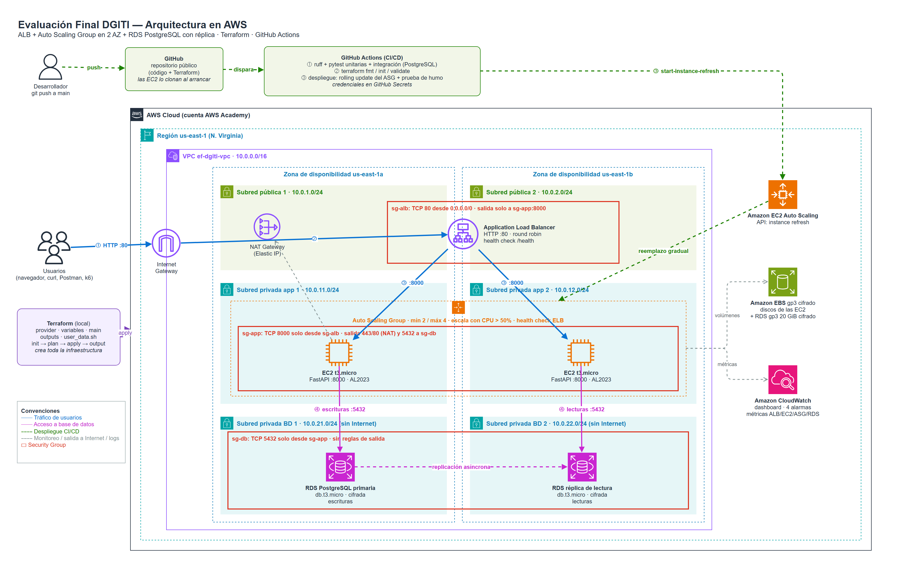

# EF DGITI — Despliegue, automatización y validación de infraestructura AWS

[](https://github.com/santiagomiri/ef-dgiti/actions/workflows/ci-cd.yml)

Evaluación Final de **Diseño y Gestión de Infraestructura Tecnológica** (Prof. Omar Pinzón Ardila).

Servicio web (FastAPI) desplegado en AWS con **Terraform**, detrás de un **Application Load Balancer**,
en un **Auto Scaling Group** repartido en **dos zonas de disponibilidad**, con **RDS PostgreSQL + réplica
de lectura** en subredes aisladas, **pipeline CI/CD en GitHub Actions**, **pruebas unitarias y de
integración**, **prueba de carga con k6** y **monitoreo en CloudWatch**.



> Diagrama editable: [`docs/arquitectura.drawio`](docs/arquitectura.drawio) (abrir en <https://app.diagrams.net>).

## Arquitectura

| Capa | Recursos | Decisión |
|------|----------|----------|
| Red | VPC `10.0.0.0/16`, 6 subredes en 2 AZ (pública, app, BD), IGW, NAT Gateway | Segmentación en 3 capas; solo el ALB y el NAT están en subredes públicas |
| Seguridad | `sg-alb` (80 desde Internet) → `sg-app` (8000 solo desde `sg-alb`) → `sg-db` (5432 solo desde `sg-app`); contraseña de la BD en SSM Parameter Store (SecureString) | Mínimo privilegio encadenado por Security Group, no por IP; sin secretos en el código ni en el `user_data` |
| Balanceo | ALB público, Target Group con health check `/health` cada 10 s | Reparte el tráfico y saca de rotación las instancias que fallan |
| Cómputo | Launch Template (Amazon Linux 2023, IMDSv2, EBS cifrado) + ASG mín 2 / máx 4, escalado por CPU 50 % | Alta disponibilidad ante fallo de una instancia o de una AZ; elasticidad bajo carga |
| Datos | RDS PostgreSQL primaria (AZ a) + réplica de lectura (AZ b), cifradas, sin acceso público | Escrituras en la primaria, lecturas en la réplica; la BD no tiene ruta a Internet |
| Almacenamiento | EBS gp3 cifrado en las instancias y RDS gp3 cifrado (20 GiB); bucket S3 de logs del ALB opcional (`enable_alb_access_logs`) | Cifrado en reposo. El bucket se apaga en el Learner Lab porque su SCP niega `s3:GetBucketObjectLockConfiguration` |
| Monitoreo | Dashboard de CloudWatch + 4 alarmas (hosts no saludables, 5XX, latencia p95, CPU de RDS) | Relacionar la prueba de carga con métricas reales |

## Estructura

```
app/                  API FastAPI (main.py, db.py, metadata.py, config.py) y dependencias
tests/                Pruebas unitarias (sin red) y de integración (PostgreSQL real)
infra/                Terraform: provider.tf, variables.tf, main.tf, outputs.tf,
                      terraform.tfvars.example, user_data.sh
.github/workflows/    Pipeline CI/CD (ci-cd.yml)
load-tests/           Prueba de carga k6 (carga.js)
scripts/              Utilidades PowerShell: credenciales, balanceo, prueba de falla, recursos, secretos
docs/                 Diagrama de arquitectura
```

## Endpoints

| Método | Ruta | Descripción |
|--------|------|-------------|
| GET | `/` | Página con la instancia, zona y versión que atendió la solicitud |
| GET | `/health` | Health check del ALB (no depende de la BD) |
| GET | `/api/info` | Identidad de la instancia en JSON |
| GET | `/api/status` | Estado de la BD primaria y de la réplica (`pg_is_in_recovery`, retraso) |
| GET | `/api/items` | Lista de ítems (lee de la réplica) |
| POST | `/api/items` | Crea un ítem (escribe en la primaria) — body `{"name": "..."}` |
| GET | `/api/compute?n=20000` | Trabajo de CPU para la prueba de carga |
| GET | `/docs` | Swagger UI |

## Despliegue

```powershell
cd infra
copy terraform.tfvars.example terraform.tfvars   # completar app_repo_url y db_password
terraform init
terraform plan
terraform apply
terraform output
```

## Pipeline CI/CD (`.github/workflows/ci-cd.yml`)

1. **Validación de código y pruebas**: `ruff` (lint + formato), `pytest` unitarias con cobertura,
   pruebas de integración contra un contenedor `postgres:16`, resumen en la página del job.
2. **Validación de infraestructura**: archivos requeridos, `terraform fmt -check`, `init`, `validate`.
3. **Despliegue** (solo en `main`): credenciales desde **GitHub Secrets**, *rolling update* del ASG (una instancia a la vez, esperando que la nueva esté sana en el ALB)
   (reemplazo gradual sin caída) y prueba de humo que verifica que todas las instancias sirven el commit nuevo.

Secretos: `AWS_ACCESS_KEY_ID`, `AWS_SECRET_ACCESS_KEY`, `AWS_SESSION_TOKEN`.
Variables: `AWS_REGION`, `ASG_NAME`, `ALB_URL` (salen de `terraform output github_actions_variables`).

## Prueba de carga

```powershell
$env:K6_WEB_DASHBOARD = "true"
$env:K6_WEB_DASHBOARD_EXPORT = "load-tests/resultados/reporte-k6.html"
k6 run -e BASE_URL=http://<dns-del-alb> -e PERFIL=estres load-tests/carga.js
# o, con todo automatizado (URL, instancias, reporte HTML y resumen):
.\scripts\prueba-carga.ps1
```

Perfiles: `humo` (5 VU, 30 s), `carga` (50 VU, 4 min), `estres` (200 VU, ~10,5 min, dispara el escalado).

## Pruebas locales

```powershell
pip install -r app/requirements-dev.txt
ruff check . ; ruff format --check .
pytest -m "not integration" --cov=app
```
